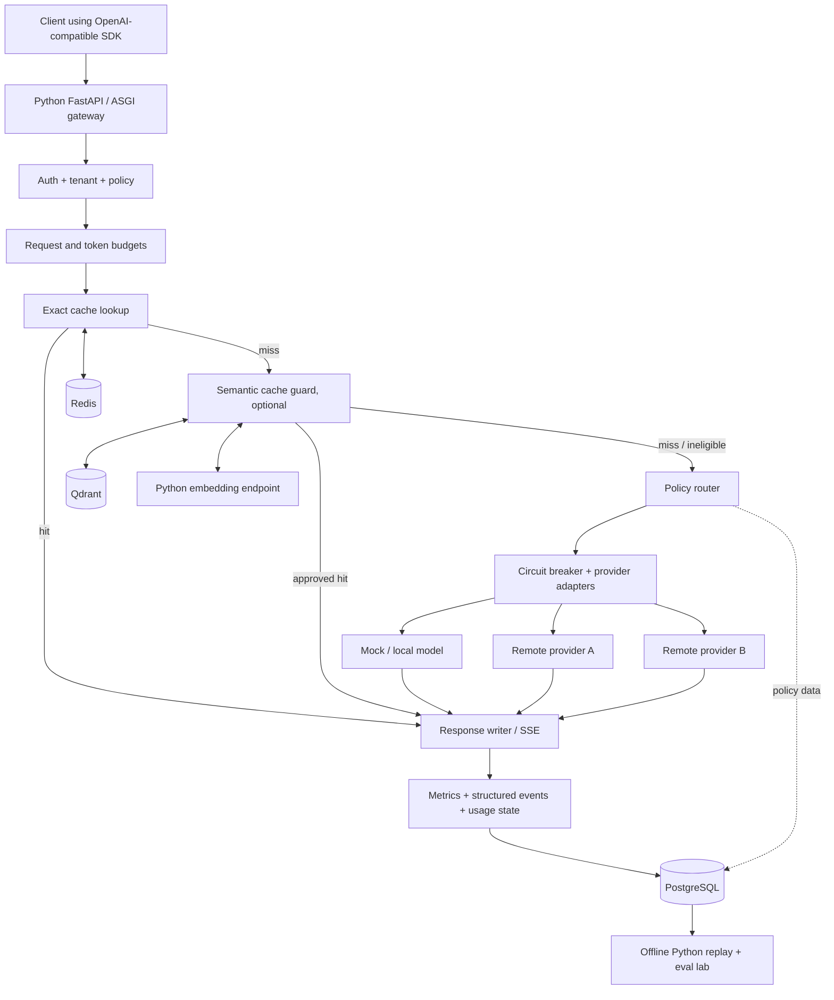

SWITCHBOARD — MASTER PROJECT CONTEXT & BUILD CONTRACT
Version: 1.1 (Python-first revision)
Prepared: October 26, 2026; revised October 27, 2026
Status: Python-first planning baseline; verify actual repository implementation status before coding
Project type: Flagship resume portfolio project
Category: Hybrid backend infrastructure + applied ML / ML systems
Working name: Switchboard (check name availability before public branding)
One-line pitch: Switchboard is an OpenAI-compatible LLM inference gateway that selects the safest cost-effective way to fulfill a request through policy-aware routing, guarded semantic caching, resilient streaming, and a counterfactual replay laboratory that measures quality, cost, and latency against explicit baselines.

Central engineering question: Can an inference gateway reduce end-to-end serving cost and latency without an unacceptable loss of answer quality, while remaining correct under provider failures, cache errors, and concurrent requests?

1. WHY THIS PROJECT EXISTS
The goal is not to build a generic chatbot, RAG assistant, model wrapper, or feature-for-feature copy of LiteLLM. Other gateways already handle provider translation, routing, retries, and several forms of caching. The differentiator is evidence-backed optimization: the system can explain and evaluate its caching and routing decisions and knows when optimization is unsafe.

The result should convince a backend / ML infrastructure hiring panel that its builder can:
1. Design and implement a robust, instrumented, low-latency Python ASGI HTTP service using FastAPI, with correctly bounded concurrency and streaming.
2. Work with streaming APIs, cancellation, concurrency, backpressure, rate limits, provider timeouts, and failure recovery.
3. Build caching with explicit correctness, isolation, invalidation and fallback behavior.
4. Evaluate embedding-based semantic similarity as a predictive system, including false positives.
5. Compare model-routing strategies under controlled, reproducible workloads using honest metrics and baselines.
6. Explain decisions, trade-offs, deployment, observability, and security at a production-minded level.
Non-objective: impressive but unverified metrics. Do not prewrite performance statistics for a resume; the numbers must be measured.
Project owner context carried over from earlier chats
- The owner is a 5th-semester ICT/computing student pursuing remote paid backend internships, junior contract opportunities, and applied ML / ML systems work. The immediate priority is a credible resume project with genuine engineering depth.
- Existing portfolio projects mentioned earlier include DevBrain MCP and RepoLens. Their precise implementations and GitHub links are not confirmed in this brief; do not infer unverified features.
- Current learning trajectory includes Python/FastAPI, APIs, PostgreSQL, Redis, caching, distributed systems, idempotency, webhooks, Docker, Kafka, LangGraph/ReAct, embeddings, and WebSockets. Some topics have been studied and others are being learned; exposure to a topic is not proof of mastery.
- The owner uses Obsidian as an interconnected learning vault, prefers structured practical notes and genuine learning, and uses GitHub for development. Encourage documenting hard concepts and active recall rather than generating lots of notes without studying.
- In the Oct 26 discussion, the owner explicitly chose Switchboard as the next resume flagship from three possibilities: an evidence-first multimodal RAG engine (ML), a durable workflow engine named Relay (backend), and Switchboard (hybrid). Switchboard is the current project; do not divert the thread into the others.
- Semester exams in the previously discussed schedule fall in late November 2026, so prioritize a demonstrable thin vertical slice and avoid open-ended architecture work before the MVP functions.
Preferences for how the new thread should collaborate
Treat the owner as an engineer building and learning, not someone who wants a fully auto-generated codebase they cannot explain. Explain tricky components at the appropriate depth, identify prerequisite knowledge, give runnable tasks with acceptance tests, and favor small, coherent GitHub commits. Push back against unnecessary technologies and unsupported performance claims. Optimize for demonstrable, interview-defensible depth.
2. PRODUCT DEFINITION
Intended users
- A small startup or engineering team calling multiple LLM providers from backend services.
- An ML platform engineer attempting to enforce per-tenant budgets, latency objectives and model-quality constraints.
- A developer who needs to understand whether caches and routing policies are saving money at the cost of wrong responses.
User story
As an application developer, I send ordinary Chat Completions requests to Switchboard instead of a particular model vendor; it enforces my policy, uses a cache only when safe, picks an eligible provider/model, streams or returns a response, records what happened, and lets me reproduce comparisons across policies.

Key differentiating features
1. Safe cache policy: exact cache by default; optional tenant-scoped semantic cache with calibrated thresholds and eligibility rules. False semantic matches are a first-class failure mode.
2. Quality-aware routing: baseline rules first, then an offline-evaluated policy that trades off model quality, predicted cost, and latency subject to explicit constraints. No unsupported claims of online learning.
3. Counterfactual replay lab: run the same representative workload under several configurations (no cache, exact cache, semantic cache, basic routing, quality-aware routing). Publish reproducible results with limitations.
4. Decision provenance: each request has traceable policy version, eligible alternatives, chosen route/cache decision, provider outcome, and usage-accounting state.
5. Failure correctness: tests for client disconnects, half-open streams, provider 429/5xx, cache/store outage, circuit breaker state, and concurrency.
Out of scope for the first release
- General-purpose agent orchestration, RAG, prompt editing, fine-tuning, distributed Raft, multimodal inputs, payment processing, Kubernetes, user-facing SaaS billing, enterprise SSO, a custom vector DB or a custom tokenizer.
- Full compatibility with every OpenAI endpoint/parameter or every provider. Support a documented subset correctly, reject unsupported parameters explicitly, and extend only when necessary.
- Claims of production readiness, exactly-once delivery, sub-15 ms semantic cache latency, or 1,500 RPS through real LLMs before measurement.
- Speculative use of seven microservices merely to make an architecture diagram busy.
3. ENGINEERING STACK: DEFAULT DECISIONS
Area	Default	Reason / alternative
Gateway	Python 3.12+, FastAPI (ASGI) + Uvicorn	Typed API contracts, async streaming, and explicit concurrency control; use framework features without hiding HTTP behavior.
ML/evaluation	Python, pandas, scikit-learn, pytest and selected evaluation libraries	Same language for the gateway and eval, but keep modules, dependencies, and runtime workloads separated.
Local embeddings	Small sentence embedding model via FastEmbed/ONNX in a separate Python worker when semantic cache phase begins	Isolate CPU-heavy inference from the gateway event loop; do not add it to Phase 0.
Database	PostgreSQL	Tenants, API keys, policy/version metadata and usage/event records.
Exact cache + rate limits	Redis	TTL, shared counters and atomic reservation algorithms.
Semantic vector index	Qdrant	Cosine similarity, metadata filters and tenant scoping. Use only once calibrated semantic cache is justified.
HTTP provider	httpx.AsyncClient (lifespan-managed) + one OpenAI-compatible adapter and deterministic mock provider	Async connection pooling; real remote provider optional via environment secrets.
Observability	Prometheus + OpenTelemetry, structured JSON logs; Grafana optional at MVP	Instrument useful traces and metrics; avoid dashboard-first work.
Load testing	k6 or Vegeta; Python eval runner for quality	Separate gateway overhead from actual provider latency.
Deploy	Docker Compose with health checks	One-command, local, reproducible demo, including no-paid-key mode.
CI	GitHub Actions	ruff, pytest, type checking, build and async concurrency/fault tests; Python has no Go-style -race switch.

Guardrail: Python is the target language for the gateway and evaluation tools. Start with the smallest FastAPI app and a deterministic mock upstream. Learn async/await, task cancellation, ASGI streaming, bounded concurrency and connection pooling as needed. Prefer well-understood Python libraries rather than introducing unnecessary services. If an unfamiliar library is proposed, explain precisely what problem it solves.
Python runtime and concurrency contract
- Use FastAPI + Uvicorn with async def for I/O-bound gateway paths, Pydantic v2 for explicit request validation, and HTTPX AsyncClient for upstream calls. Create and close shared clients with FastAPI's lifespan; do not instantiate a new HTTP client for every request.
- Keep blocking network/database SDKs, time.sleep, synchronous file I/O and CPU-heavy embedding inference off the event loop. Use async Redis/PostgreSQL clients when those phases arrive; use a bounded worker pool or separate worker process for CPU-bound tasks. The GIL is not a substitute for concurrency design.
- Implement streaming with an ASGI-compatible async iterator (for example StreamingResponse) that forwards valid SSE records incrementally and closes the upstream response on completion, cancellation or failure. Correctly scope HTTPX streaming contexts so connections stay open during downstream iteration.
- Use AnyIO/asyncio cancellation and deadlines; detect disconnects and ensure cleanup in finally where applicable. A timeout or cancellation must not leave an upstream request, semaphore slot, task or pooled connection stranded.
- Bound simultaneous upstream requests with explicit semaphores/queues and measured limits. Initially run a single Uvicorn worker for predictable tests; scale processes only after measuring and verifying that shared state, locks, budgets and circuit breakers work across workers.
- Use structured request context (contextvars/OpenTelemetry where useful), not mutable module globals, for per-request metadata. In-process locks/flight suppression are not distributed guarantees.
- Test cancellation and real SSE wire behavior through an actual Uvicorn server in integration tests; HTTPX ASGI transport/unit tests alone do not prove client-disconnect or socket backpressure behavior.
- Benchmark Python overhead explicitly: event-loop blocking, p50/p95/p99, TTFT, memory, CPU, open connections and sustained concurrency. Report backend overhead separately from mocked/real LLM latency; do not assume Go-like throughput.
Provider scope: For MVP use POST /v1/chat/completions as the externally visible compatibility target, even though newer OpenAI applications may prefer Responses. Document that this is a subset and consider Responses API in a later milestone. Do not silently claim feature parity.
4. HIGH-LEVEL ARCHITECTURE

Architectural policy: Begin as a modular monolith for the Python FastAPI gateway. A standalone Python mock provider and later CPU-isolated embedding worker are practical test/deployment components, not an excuse for premature microservices.
Request lifecycle
1. Assign server-generated request ID + tracing context. Parse/validate request; enforce size and supported parameter bounds.
2. Authenticate API key; derive tenant ID from trusted server-side identity, never from arbitrary client-provided tenant fields.
3. Resolve immutable policy snapshot/version, request limits, eligible model capabilities and data-handling restrictions.
4. Apply request-rate limits and preflight token-budget reservation/estimate (do not trust raw client-supplied token counts).
5. Consult exact cache if request is eligible. Include tenant, model/task identity, system/developer prompts, input messages, sampling/tool parameters, response format and policy/version where relevant in a canonical key. Do not normalize away meaningful semantics.
6. If enabled, use semantic cache only if policy permits this request class; vector similarity is a candidate signal, not proof that the cached answer is valid. Enforce tenant filter, metadata versions, TTL and guard checks before serving.
7. For a miss, pick an eligible provider/model using deterministic baseline policy and healthy-provider state; support only documented fallbacks.
8. Proxy non-streaming JSON or stream SSE events without buffering the full completion. Honor cancellation, deadlines, backpressure and downstream disconnects.
9. Record route, provider failure state, cache decision, latency, known/estimated usage, cost model version, and trace IDs without logging private payloads by default.
10. On eligible successful responses, insert cache data asynchronously/after successful completion according to policy. Do not cache interrupted, partial or erroneous streams as successful responses.
Streaming-specific rules
- Support well-defined SSE framing for the selected Chat Completions subset. Preserve chunk order and termination semantics.
- stream_options.include_usage can produce a terminal usage chunk. If the client disconnects or a stream fails, this chunk may never arrive. Report unknown/estimated usage explicitly; never quietly record zero as actual consumption.
- Once client-visible output has started, silently restarting against a different model is not a transparent retry. Before first byte, retry/fallback can be permitted by policy. After first byte, end/report the failed stream; expose a clear documented contract.
- Flush SSE chunks without buffering the full result; propagate ASGI/AnyIO cancellation and downstream disconnects upstream; close HTTPX streams and ensure no leaked tasks, semaphore permits, or connections. Test slow clients over real sockets.
- Report TTFT (time to first token) and full completion time separately.
5. SUBSYSTEM DESIGN CONTRACTS
A. Gateway API / security
MVP endpoint: POST /v1/chat/completions, covering text-only model, messages, basic generation settings, stream, and stream_options.include_usage if supported by upstream. Express the supported schema with strict Pydantic v2 models (extra="forbid" where appropriate) and deliberate response/error mapping; FastAPI's automatic 422 behavior must be documented or translated for the advertised OpenAI-compatible subset. Explicitly document parameter translation. Useful extras: GET /healthz, GET /readyz, protected GET /metrics, optionally GET /v1/models.
- Use separate public data-plane and authenticated admin/control-plane actions; no unauthenticated admin endpoints.
- Store only salted/secure hashes or otherwise appropriately protected representations of application API keys; never echo provider credentials.
- Provider keys come from environment/secret store, not source control; never copy actual keys into logs or traces.
- Enforce max request size, finite timeouts, controlled concurrency, safe outbound destination allowlists, safe error messages and protection against SSRF when configurable base URLs exist.
- Rate-limit both requests and tokens; protect against cross-tenant cache reads. Disable storage of raw prompts/responses by default or make sensitive-data retention explicitly opt-in and documented.
B. Exact caching
- First implementation: Redis with TTL and a versioned canonical request key. Hash stable serialization; canonicalization must preserve semantically relevant order and content.
- Partition by tenant and policy scope. Include model identity and parameters that affect output. Don't reuse cached content across users or policies by accident.
- Handle concurrent identical requests with optional singleflight/cache stampede protection, without introducing indefinite locks.
- Separate cached result format for non-streaming versus the optional ability to reconstitute valid SSE for cache hits; do not replay arbitrary previous transport fragments if they contain stale IDs/metadata.
- Fallback behavior on Redis outages is a configurable bypass cache and call provider with explicit budget/rate-limit safety constraints.
C. Semantic caching
- Cache only a narrowly specified subset at first: tenant-scoped, text-only, no tools, no personalized or time-sensitive questions, stable instructions, compatible generation settings/model family.
- Use embedding similarity to propose a hit; calibrated quality guard must approve. A threshold such as 0.95 is not intrinsically safe and must not be presented as universal.
- Create a labeled dataset of semantic equivalents and hard negatives: differing quantities, negation, changing dates, personal context, changed system instructions, near-identical questions requiring different answers, stale facts, ambiguous names.
- Measure precision/false-positive rate on cache decisions, cost and coverage across held-out cases. Preference is for high cache-hit precision, even at lower coverage.
- Separate Qdrant vector metadata from Redis cached response; handle TTL, expiration, delete, invalid refs and race conditions. Require server-side tenant filters in Qdrant and integration tests for isolation.
- Track cache model/embedding model version; invalidation is a correctness mechanism, not housekeeping.
D. Model routing
- Baselines: fixed model, cheapest eligible model, simple weighted or rule-based routing. These baselines are necessary before any ML-style router.
- Policy constraints: approved provider/model set, required capabilities, maximum cost budget, latency SLO, tenant restrictions, model-quality floor, provider health.
- Early implementation: readable rule-based classifier by task category (simple QA, extraction, summarization, coding, reasoning) with known limitations. Model-based classifier is a stretch justified only after offline evaluation.
- Training/eval: curate tasks with objectively verifiable checks where possible and a small human-reviewed rubric set for subjective tasks; avoid sole dependence on one LLM judge and guard against data leakage. Split train/dev/test by task families when practicable.
- Persist policy version so counterfactual replay is reproducible. Use a cost model with recorded model-specific input/output pricing snapshots; never assume prices stay constant.
- Cache hit and router quality should be evaluated jointly and individually so improvements aren't conflated.
E. Provider resilience
- Use per-provider and per-model timeouts, bounded retries with exponential backoff/jitter, 429 handling with Retry-After when available, and circuit breakers with minimum sample sizes.
- The previous suggestion to open a circuit at more than 5% failures is not universal. Use a configurable rolling-window breaker, cool-down and half-open probes, with tests and clear denominator.
- Avoid unsafe retries after partial streaming output; ensure idempotency/cost implications are documented for upstream requests.
- In Python, do not catch and suppress task cancellation as a generic provider error. Retain CancelledError propagation and cleanup; never let broad exception handlers accidentally turn a cancelled stream into a successful cached response.
- Support provider simulation with controllable latency, errors, truncation, mid-stream disconnects and concurrency limits.
F. Budgets, usage and observability
- Distinguish RPM (request rate), TPM (tokens per minute) and spend. Rate limiting alone is not budget enforcement.
- For TPM use conservative pre-reservation/estimated tokens plus post-response reconciliation where possible; decide how to handle uncertain/missing usage. Implement atomic shared counters via Redis scripting or equivalent and test concurrency.
- Store a request event/ledger with a unique request ID and usage status: actual, estimated, or unknown. Handle duplicate event writes idempotently.
- Useful metrics: gateway request counts; per-route/cache counts; provider requests, errors and breaker states; p50/p95/p99 HTTP latency; TTFT; cache lookup latency; token reservation denials; actual/estimated spend; cache false-hit rate from eval (not usually observable in production without labels).
- Trace spans: validate/auth, limits, cache, embedding lookup, route decision, provider HTTP, stream flush and usage persistence. Hash or redact labels so metrics have bounded cardinality. No prompt bodies in tracing by default.
6. DATA AND CONFIG DESIGN (PROPOSAL)
Python data-access defaults (introduced only when needed): Prefer SQLAlchemy 2.x async with asyncpg for relational persistence (or direct asyncpg if a smaller abstraction is sufficient); redis.asyncio for Redis; an async-compatible Qdrant client for vector operations. Configure connection pools, per-operation timeouts and explicit transaction boundaries. Do not add databases merely for the Phase 0 demo.

PostgreSQL minimum:
- tenants: id, name, status, created_at.
- api_keys: id, tenant_id, key_hash, scopes, revoked_at, created_at.
- policies: id, tenant_id, version, config_json, active_at; policy version is immutable after publish.
- requests: id, tenant_id, policy_version, started_at, finished_at, request_status, cache_status, chosen_provider, chosen_model, latency_ms, ttft_ms, usage_state, input_tokens, output_tokens, estimated_cost, cost_version, error_code.
- provider_health_events (optional): timestamp, provider, model, failure class, breaker event.
- evaluations: run_id, git_sha, dataset_version, policy_version, model/version metadata, workload, hardware, aggregate metrics, raw-results location.
Redis: cache entries with TTL and versioned keys; request/token limit counters; optional short-lived singleflight lease.

Qdrant: vectors plus mandatory tenant/policy/embedding-version metadata, optional Redis response pointer, creation time and expiry. Ensure response lookup checks the Redis entry still exists and that scope matches.

Configuration: environment variables for secrets, checked-in sample config for model aliases/provider endpoints, explicit schema validation; deterministic fake model/provider requires no API key. Never make unknown provider/model costs look like known facts.
7. EVALUATION AND REPRODUCIBLE BENCHMARKING
The project's primary artifact is evidence, not only code. Build an eval/ subsystem with dataset definitions, runners, grading, and reports.
Evaluation tasks
- Stable, objectively verifiable tasks: structured extraction, classification, basic reasoning questions with reference answers, code tasks with tests (where feasible).
- Controlled paraphrase pairs and hard-negative near-matches for semantic caching.
- A smaller hand-reviewed subset for ambiguous or qualitative tasks, with documented rubric and error categories.
- Different prompt lengths, streaming/non-streaming, different request mixes and failure distributions.
- Separate development data (choose thresholds and policies) from held-out test data (final results). Publish dataset construction constraints and uncertainty.
Required policy comparisons
1. Fixed capable model, no cache (quality baseline).
2. Same model, exact caching.
3. Same model, exact plus guarded semantic caching.
4. Two-model rule-based routing, no semantic cache.
5. Quality-aware routing with caching (proposed full system).
Keep model outputs, prompt versions and evaluation definitions comparable. Repeat runs; for stochastic models report variation and model/provider versions.
Benchmark workloads
- W1 unique prompts: little/no cacheability.
- W2 repeated exact prompts: tests exact cache and hot-key behavior.
- W3 safe paraphrases plus hard negatives: tests semantic cache precision and coverage.
- W4 mixed realistic traffic: declared proportions by category, input length, and cacheability.
- W5 fault injection: timeouts, 429, 5xx, Redis/Qdrant outage, client cancel, mid-stream disconnects.
- W6 load/concurrency: controlled mocked providers to isolate gateway overhead, then separate low-volume real-provider runs to measure end-to-end behavior.
Report metrics and denominators
- Answer quality/accuracy/pass rate on fixed labeled tasks; compare versus baseline.
- Semantic cache precision, false-positive rate, hit coverage and incorrect-response rate by task class.
- Cost per acceptable answer and total expected billed token cost; record model pricing snapshot, retries and overhead (embedding cost/compute) when applicable.
- p50/p95/p99 latency, TTFT, RPS and error rate by workload, with cache hit/miss broken out.
- Resource usage: Python/Uvicorn RSS/CPU, event-loop lag, connection-pool saturation, worker/process count, Redis/Qdrant memory, embedding worker CPU/memory and hardware specs.
- Reliability outcomes: successful requests, partial streams, appropriate errors, cross-tenant leakage tests and lost accounting records under injected failures.
- For each test: git commit SHA, command, config, dataset version, run count, machine, concurrency, durations, real/mocked provider and known limitations.
Critical benchmark honesty: A mock LLM can show gateway throughput, not production provider throughput. A fast cache hit versus a 1.5 s provider call does not mean actual model inference accelerated. Never combine these into a misleading blanket p95 claim. Do not show cost savings without including quality degradation and workload mix.

Success is comparative, not invented: A compelling result might be significantly lower cost at a small measured quality delta, or identifying that semantic caching is unsafe for some categories and rejecting those hits. No metric target is claimed as achieved in advance.
8. DELIVERY PHASES AND ACCEPTANCE GATES
Avoid rigid deadlines; deliver vertical slices. Concentrate on the first demo before exam-heavy periods.
Phase 0 — Product specification and repo skeleton (small)
Build: README.md elevator pitch/non-goals, docs/architecture.md, one ADR for Python/FastAPI/Chat Completions, pyproject.toml + locked dependencies, minimal src/ package, .env.example, lint/test configuration, optional Makefile, Docker Compose for gateway+mock provider. Commit after it runs.

Gate: docker compose up --build works without paid credentials, and health endpoint + deterministic mock endpoint respond. A local uv run pytest (or documented pip equivalent) passes. No Redis/Qdrant/Postgres yet unless required.
Phase 1 — Real working gateway MVP (highest priority)
Build: FastAPI ASGI API, Pydantic v2 request validation, explicit supported parameter subset, client -> gateway -> mock provider passthrough via shared httpx.AsyncClient, optional real OpenAI-compatible endpoint, timeouts, request ID, task cancellation, non-streaming and correct SSE stream forwarding via async iterators. Test malformed bodies, dropped streams, and upstream connection cleanup.

Gate: A client points a standard SDK (for the supported Chat Completions subset) at local Switchboard and completes normal + streaming calls; cancellation stops upstream work. Integration tests cover partial SSE and timeout boundaries.
Phase 2 — Backend reliability
Build: provider registry, typed errors, retry classifier, pre-first-byte fallback, circuit breaker, basic tenant auth, exact cache + TTL, simple Redis rate limits and metrics.

Gate: deterministic failover/fault injection proves behavior; exact cache key isolates tenants; outage of a non-critical cache does not take down allowed requests; benchmarks distinguish cache hit/miss. Tests also verify no event-loop blocking under concurrent requests, bounded upstream concurrency and safe connection cleanup.
Phase 3 — Controlled semantic caching
Build: local embedding worker, Qdrant integration, strict semantic cache eligibility, tenant/version filters, hard-negative dataset, calibration notebook and false-hit tests.

Gate: safe semantic hit decisions demonstrated on held-out labeled pairs; mis-scoped and ineligible requests bypass; false-hit/coverage curve is reproducible; no privacy leaks.
Phase 4 — Quality-aware routing + replay lab
Build: fixed-model baseline, rules router, quality constraints and provider eligibility, cost ledger/pricing version, replay runner, evaluation reports. Consider learned router only if simple baseline is demonstrated.

Gate: published, reproducible comparative analysis of quality, cost, latency and reliability over several workloads; claims include uncertainty and negative results.
Phase 5 — Portfolio polish and deployment
Build: CI (ruff, type checks, pytest, package build, async concurrency/fault tests), Docker Compose health checks, dashboard if metrics warrant it, ADRs, README GIF/video, design trade-offs, load test scripts, GitHub issues/releases, minimal hosted demo if safe/budgeted. Add only one stretch feature chosen from: local vLLM integration, policies for tool calls, Responses API, or a lightweight UI.

Gate: a stranger can clone, launch in mock mode, use one SDK example, run tests, reproduce a benchmark and explain core decisions using documentation. Python package installs from a documented locked environment and passes imports without custom PYTHONPATH tricks.
The first 3 coding sessions
1. Session 1: initialize switchboard with pyproject.toml, FastAPI/Uvicorn and pytest; implement GET /healthz and a deterministic mock upstream; one e2e test, Docker Compose, README smoke test. Create/close a lifespan-managed HTTPX client.
2. Session 2: implement POST /v1/chat/completions with Pydantic v2 text-only validation, async HTTPX non-streaming forwarding, upstream timeout handling and tests.
3. Session 3: implement StreamingResponse SSE relay with properly scoped upstream HTTPX streaming, client-cancel propagation and real-server tests for clean completion, mid-stream error, early disconnect and connection cleanup.
Never build the React dashboard or semantic model before these are passing.
9. PROPOSED REPOSITORY LAYOUT
switchboard/
├── src/
│   └── switchboard/
│       ├── __init__.py
│       ├── main.py                # FastAPI app factory + lifespan
│       ├── api/                   # Pydantic contracts + HTTP/SSE handlers
│       ├── auth/                  # tenant identity (phase 2)
│       ├── config.py              # typed settings
│       ├── providers/             # HTTPX adapter + errors + retries
│       ├── routing/               # eligibility and policy engine
│       ├── caching/               # exact and later semantic
│       ├── limits/                # requests/token budgets
│       ├── usage/                 # ledger and estimation state
│       └── telemetry/             # logs, metrics, traces
├── services/
│   ├── mock_provider/            # separate deterministic FastAPI upstream
│   └── embedder/                 # phase 3 only; CPU-isolated worker
├── eval/
│   ├── datasets/                 # public/synthetic, no secrets or PII
│   ├── scripts/                  # replay and grading
│   ├── baselines/
│   └── reports/                  # reproducible outputs
├── tests/
│   ├── unit/
│   ├── integration/             # real-server SSE + disconnect tests
│   └── fault/
├── deploy/
│   └── compose.yaml
├── docs/
│   ├── architecture.md
│   ├── api-contract.md
│   ├── evaluation-methodology.md
│   ├── failure-model.md
│   ├── threat-model.md
│   ├── benchmark-results.md
│   └── adr/
├── .github/workflows/
├── .env.example
├── pyproject.toml              # dependencies + build + ruff/pytest settings
├── uv.lock                     # if uv is selected; commit lockfile
├── Makefile                    # optional local dev commands
└── README.md
Keep directories uncreated until their first code is necessary. The tree is an end-state proposal, not a command to generate empty placeholders.
10. TEST AND FAILURE MATRIX
Scenario	Expected invariant / behavior
Missing, revoked, other-tenant API key	Reject; no tenant data leaked.
Malformed JSON, oversized message, unsupported parameter	Stable 4xx with clear, non-sensitive error; no upstream request.
Provider timeout before first byte	Bounded retry/fallback per policy; finite request deadline.
Provider failure after streaming started	Do not silently splice another provider stream; error/terminate per documented contract.
Slow client / cancelled ASGI request	No stuck tasks or leaked connections; upstream cancelled; accounting marked uncertain if necessary.
Provider 429/5xx	Retry only if class/policy permits; honor Retry-After appropriately; circuit state correct.
Redis down	No unintended outage from cache miss/bypass; budget enforcement must define safe failure behavior.
Qdrant down	Semantic lookup bypass and route to provider if allowed; never return a random/foreign result.
PostgreSQL down	Defined degraded/fail-closed mode for auth, policy and spend; no insecure bypass.
Two tenants send same prompt	Cache keys, vector filters, metrics and usage records remain isolated.
Concurrent same-key requests	No corrupt cache, race, duplicate ledger record, unbounded lock or stampede beyond configured policy.
Semantic hard negative	Similar embedding alone does not qualify as verified answer equivalence.
Stream aborts before usage chunk	Usage state is unknown/estimated, not falsely actual=0.
Policy or model version changes	Cache invalidation/scope works; replay uses recorded immutable policy version.
Open circuit + half-open retry	Sane minimum sample, time windows and controlled probe volume.

Test layers: Python pytest unit tests, pytest-asyncio/AnyIO async tests, HTTPX client tests, real Uvicorn + socket-level SSE/disconnect tests, concurrency/stampede and resource-cleanup tests, PostgreSQL/Redis/Qdrant container integration where relevant, evaluation tests, security-isolation tests, deterministic failure/chaos tests, and k6 load tests. Python does not have a direct go test -race equivalent: explicitly test simultaneous requests, shared-state races and event-loop blocking. Not all layers are needed on day one.
11. README AND RESUME EVIDENCE PACKAGE
An excellent final GitHub repository should have:
1. One-sentence problem/solution and 1-minute demo.
2. Compact architecture figure and request flow, with components justified.
3. Quick start: docker compose -f deploy/compose.yaml up --build and curl / SDK example in no-paid-key mode.
4. API support matrix with intentionally unsupported features.
5. Clear security and operational limitations, including data retention and cache isolation.
6. Benchmark methodology, hardware, workload proportions, repeated runs and reproducible scripts.
7. A results table comparing fixed/no cache, exact cache, semantic cache, and routing on quality, $/acceptable answer, p95, TTFT, false-cache-hit rate and error rate. Populate after experiments.
8. Failure and chaos demonstrations: screenshots or short recordings of injected 429, timeout, redis outage, broken SSE and breaker transitions.
9. ADRs explaining why Python/FastAPI/HTTPX, Redis and Qdrant were selected and how cancellation, concurrency, fallback and stream accounting semantics work.
10. Known limitations + future improvements to show engineering maturity.
Resume bullets: templates, not achievements
- Backend angle: "Built a Python/FastAPI LLM inference gateway supporting authenticated multi-tenant routing, async SSE streaming, circuit breakers, and fault-injection tests; demonstrated [measured p95 / throughput / failure-recovery result] on [specified workload]."
- ML systems angle: "Designed and evaluated a guarded semantic cache and quality-aware inference router; achieved [measured cost change] at [measured answer-quality change] on [N] held-out tasks, with [measured false-hit rate]."
- Full hybrid angle: "Engineered Switchboard, a Python-based inference gateway and evaluation system with policy-aware routing, tenant-isolated caching, and reproducible quality-cost replay experiments; measured [true outcomes] against [named baseline]."
Do not use 38% savings, 22ms p95, 1,500 RPS or any other number until experiments substantiate it. Record negative results honestly.
12. PROJECT MANAGEMENT, LEARNING, AND CONTINUITY
Work tracking
- Use GitHub Issues or a small project board with phase, bug, test, docs, research, benchmark, security, stretch labels; each issue has acceptance criteria.
- Prefer short PR-sized increments and commit messages explaining intent. Avoid producing an opaque giant scaffold.
- Record decisions in docs/adr/NNN-title.md, with context, options, rationale, implications and reversal criteria.
- Track hypotheses separately from results. A README claims table should label "target / not yet measured" until proof exists.
- Keep a docs/PROJECT_STATUS.md log: implemented, passing tests, known bugs, next issue, blocked-by, last benchmark. This is the handoff anchor for subsequent threads.
Learning notes to link in Obsidian
- Python backend: FastAPI, Pydantic v2, ASGI/Uvicorn, async/await, AnyIO/asyncio cancellation, async iterators, HTTPX pooling, backpressure, event-loop blocking and task supervision.
- API and networking: reverse proxies, SSE vs WebSockets, HTTP chunking, cancellation/backpressure, timeouts.
- Reliability: circuit breakers, bounded retries/jitter, rate limiting/token buckets, idempotency, eventual consistency in usage ledgers.
- Data: Redis TTL and atomic operations, PostgreSQL constraints/transactions, vector cosine similarity, Qdrant metadata filters.
- ML: embeddings, calibration/precision/recall, cost-sensitive decision-making, dataset leakage, LLM evaluation limitations.
- Systems measurement: p95/p99, TTFT, CPU/memory profiling, load-model design, OpenTelemetry context propagation.
Follow the user's established Obsidian canonical note linking conventions (e.g. [[Redis]], [[Distributed Systems]], [[Embeddings]], [[WebSockets]]) where these notes exist. Do not mislabel a topic as learned simply because a page was generated.
Risks and mitigation
- Scope explosion: finish phase 1 before semantic/vector machinery and UI.
- Python async correctness and everything else: implement one small API capability at a time, with tests and brief explanations; do not assume that using async def automatically makes blocking code scalable.
- External API spending: mock provider by default, explicit cost limits for any live runs.
- Fake benchmark wins: baseline/workload/hardware documented; separate mock and live numbers.
- Leaky semantic cache: strict eligibility, tenant/version filters, held-out hard negatives, no sensitive prompt retention by default.
- Cross-provider inconsistency: explicit model capabilities, honest subset of API compatibility.
- Time constraints: favor a polished, functioning vertical slice over a half-built feature matrix.
13. SUCCESS CRITERIA
Minimum viable flagship
- Working SDK-compatible (declared subset) gateway with mock mode and streaming.
- Authentication/tenant identity, exact caching, reliable provider failover, deadlines and cancellation.
- Fault-injection integration tests, instrumentation, reproducible container deployment.
- Baseline benchmark with honest gateway-only numbers and at least one documented trade-off.
Strong full version
- Calibrated semantic caching with hard-negative evaluation, versioned isolation, measured precision/coverage trade-off.
- Quality-aware model routing compared against fixed-model and cost-only baselines.
- Replay/evaluation harness with held-out tasks, quality/cost/latency report, raw scripts/configs.
- Clear security/failure model, meaningful metrics, docs and demo.
Stretch only after above
- Local vLLM serving, Responses API support, adaptive routing model, lightweight policy UI, multi-instance testing, model-specific prompt-cache routing, or public hosted demo with stringent budget caps.
14. REFERENCE BASELINES / OFFICIAL DOCUMENTATION
These links are for technical verification and competitor baselines, not an invitation to copy their entire design.
- LiteLLM routing and architecture: https://docs.litellm.ai/docs/routing and https://docs.litellm.ai/docs/proxy/architecture
- LiteLLM exact/semantic caching overview: https://docs.litellm.ai/docs/proxy/caching
- OpenAI Chat Completions reference: https://developers.openai.com/api/reference/resources/chat/subresources/completions/methods/create
- OpenAI SSE streaming guide: https://developers.openai.com/api/docs/guides/streaming-responses
- OpenAI streamed usage details: https://help.openai.com/en/articles/10478918-reviewing-api-usage-and-costs
- Qdrant tenant isolation/indexing: https://qdrant.tech/documentation/manage-data/multitenancy/ and https://qdrant.tech/documentation/manage-data/indexing/
Check current versioned documentation before hardcoding provider behavior, pricing or compatibility promises.
15. AI COLLABORATOR INSTRUCTIONS FOR THE NEXT THREAD
You are the project's pragmatic staff engineer, ML systems architect, code reviewer and tutor. Treat this document as the project's planning source of truth, revising it when experiments and explicit decisions warrant updates.
1. Start with Phase 0 / Phase 1, not a 30-page speculative design phase. Provide the immediate milestone, implementation plan, files and acceptance tests. The first thing to implement is an HTTP server + deterministic fake provider.
2. Be critical. Challenge unnecessary tools, fragile semantics, unmeasurable claims and scope creep. Tie every feature to a product requirement or interview-defensible experiment.
3. Explain how parts work and why they're needed, especially Python ASGI concurrency, async/await, cancellation, HTTP/SSE streaming, distributed failures, cache correctness, ML threshold evaluation and benchmarking. The user wants to learn, not blindly paste code.
4. When coding, produce idiomatic, runnable code in small increments; include filenames, commands, tests and expected behavior. Favor standard library before complex dependencies.
5. Distinguish confirmed implemented, proposed, aspirational metric and verified result. Never invent benchmark outcomes, GitHub commits, tests or repo state.
6. Implement a mock provider path that works without vendor API keys. Paid provider integrations and expensive evaluations must be opt-in, with budget controls.
7. Keep threat model and tenant isolation in scope from the beginning, without prematurely implementing enterprise features.
8. Prefer deterministic tests and realistic baselines. Do not paper over broken streaming, unknown token usage or post-first-byte failover semantics.
9. Recommend an Obsidian note only when it supports active learning, linking canonical existing notes when known. Don't flood the learning vault with duplicate pages.
10. At the end of each meaningful work session, summarize: completed work, exact files changed, tests run/results, new decisions, blockers, and next 1–3 prioritized tasks. Update the status document if file access is available.
11. Adapt to the user's current environment and installed tools when they are known. Don't assume Python 3.12+/uv/Docker/PostgreSQL are installed, don't assume a GitHub repo already exists, and don't claim the project is deployed.
12. Do not ask a long questionnaire. Choose sensible defaults and ask only for an environment-specific fact that genuinely blocks the next executable step.
Opening action in the new thread: Acknowledge Switchboard as the selected flagship project, summarize the single next technical milestone, then provide the initial repo setup + smallest working Python/FastAPI gateway/mock-provider implementation plan and acceptance tests. Advance phase by phase.

End of master context.