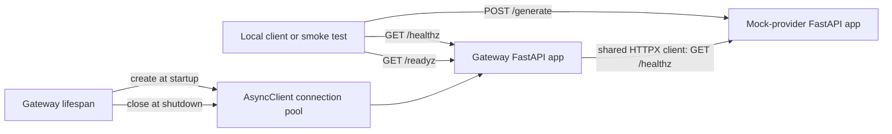

# Architecture

## Status and scope

This document describes only the code that exists through Phase 0C and the Phase 0D audit immediately ahead. The broader product direction remains in [`BUILD_CONTRACT.md`](BUILD_CONTRACT.md); it is not an assertion that those systems already exist.

## Current architecture: Phase 0C

The current system is an installable Python distribution containing two independent FastAPI/ASGI applications connected by one minimal readiness request:

```text
client -- GET /healthz --> gateway application
client -- GET /readyz --> gateway -- shared AsyncClient --> mock GET /healthz

test client -- GET /healthz --> mock-provider application
test client -- POST /generate --> validation --> SHA-256 derivation --> mock response
```

Uvicorn runs each application as a separate process. FastAPI routes requests and serializes responses; strict Pydantic models reject unknown or invalid fields. The mock response is a pure function of a canonical JSON representation of the validated request, so it has no dependency on randomness, time, network calls, or process-local state.

The gateway uses the mock provider only for readiness. There is no request forwarding, persistent store, cache, router, provider adapter, or evaluation workload.



## Application factories

`switchboard.gateway.create_app()` and `switchboard.mock_provider.create_app()` each return a new FastAPI instance. This keeps process construction explicit, avoids mutable global application state, and lets tests create isolated instances. Uvicorn receives the factory with `--factory` and owns the network listener and event loop.

## Current request flows

```text
gateway: GET /healthz
  -> route handler
  -> HealthResponse
  -> JSON 200

mock: POST /generate
  -> Pydantic validation
  -> canonical JSON serialization
  -> SHA-256 digest
  -> MockGenerationResponse
  -> JSON 200
```

Validation failure stops before response generation and produces FastAPI's HTTP 422 validation structure. Both applications also expose independent health routes.

## Resource lifecycle

The gateway's lifespan context creates one `httpx.AsyncClient` before accepting requests, stores it in application state, and closes it after the lifespan exits. Every readiness request retrieves that same client. Tests hold a reference across lifespan shutdown and assert `is_closed`, proving cleanup without relying on garbage collection.

Creating a client per request was rejected because it would discard connection pooling and make socket cleanup harder. CPU work and synchronous blocking calls remain prohibited on the event loop in later phases.

## Container topology

Both services use one locked, non-root image, built once from the mock-provider service definition and reused by the gateway. Compose starts the mock provider first, waits for its `/healthz`, then starts the gateway with `SWITCHBOARD_MOCK_PROVIDER_URL=http://mock-provider:8001`. Gateway health checks call `/readyz`, proving service discovery and upstream reachability rather than process liveness alone. Only ports 8000 and 8001 are published to host loopback.

## Immediately planned architecture: Phase 0D

Phase 0D will audit the complete Phase 0 diff for scope creep, repeat clean-start local and Compose verification, tighten troubleshooting documentation, and push/open the PR without merging it.

## Deferred architecture

Redis, PostgreSQL, Qdrant, authentication, tenant budgets, semantic caching, policy routing, circuit breakers, metrics infrastructure, replay evaluation, Chat Completions proxying, SSE, and production deployment remain deferred. Their appearance in the build contract is roadmap context, not current implementation status.
