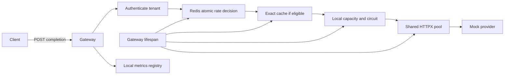

# Architecture

## Status and scope

This document describes the merged gateway and backend reliability capabilities, plus the optional
isolated embedding worker. The
broader product direction remains in [`BUILD_CONTRACT.md`](BUILD_CONTRACT.md); it is not an
assertion that those systems already exist.

## Current architecture: gateway controls, exact cache, and optional embedding worker

The completion route first receives a typed `TenantIdentity` through FastAPI dependency injection.
An `ApiKeyAuthenticator` compares the incoming bearer key's SHA-256 digest with configured tenant
digests and rejects unknown or revoked keys. For an eligible buffered request, `ExactCache` hashes
canonical tenant, provider-policy, schema, and request data into a Redis key. A valid hit returns
without upstream work. Misses, corrupt entries, and isolated cache-command failures proceed to the provider after a valid rate decision. A
successful provider result is stored with `SET EX`; write failure does not change the response.
Streaming and configured-secondary policies bypass the cache. See
[`ADR 0003`](adr/0003-tenant-auth-exact-cache.md).

The public route now receives a lifespan-owned `ReliableProviders` object. It selects a named
adapter from `ProviderRegistry`, consults that adapter's process-local breaker, and makes bounded
sequential attempts under one deadline. The optional secondary is a second configured mock URL and
HTTP client. Circuit state remains process-local. See
[`failure-model.md`](failure-model.md) and [ADR 0002](adr/0002-retry-fallback-circuit.md) for exact
failure transitions, limits, and cancellation rules.

The current system is an installable Python distribution containing two independent FastAPI/ASGI applications connected by one minimal readiness request:

```text
client -- GET /healthz --> gateway application
client -- GET /readyz --> gateway -- shared AsyncClient --> mock GET /healthz
OpenAI SDK or HTTP client -- POST /v1/chat/completions --> gateway validation --> provider adapter
  --> shared AsyncClient --> mock POST /v1/chat/completions --> validated response
client -- stream:true --> gateway preflight first SSE event --> async forwarding --> [DONE]

test client -- GET /healthz --> mock-provider application
test client -- POST /generate --> validation --> SHA-256 derivation --> mock response
test client -- POST /v1/chat/completions --> strict contract --> deterministic Chat Completion
```

Uvicorn runs each application as a separate process. FastAPI routes requests and serializes responses; strict Pydantic models reject unknown or invalid fields. The mock response is a pure function of a canonical JSON representation of the validated request, so it has no dependency on randomness, time, network calls, or process-local state.

The Chat Completions request and response models live in the shared boundary-contract module.
The gateway depends on the small `ChatProvider` protocol; `ReliableProviders` composes named
`HttpxMockProvider` adapters that borrow lifespan-managed clients. Redis holds exact cache entries
and rate counters. There is no PostgreSQL, semantic cache, learned router, or representative
evaluation workload. An isolated FastAPI embedding worker is available through an opt-in Compose
profile. It owns a pinned CPU ONNX model and bounded inference threads, but the gateway does not
call it yet. See [embedding-service.md](embedding-service.md) for its contract and ownership.



## Application factories

`switchboard.gateway.create_app()` and `switchboard.mock_provider.create_app()` each return a new FastAPI instance. This keeps process construction explicit, avoids mutable global application state, and lets tests create isolated instances. Uvicorn receives the factory with `--factory` and owns the network listener and event loop.

## Current request flows

```text
gateway: GET /healthz
  -> route handler
  -> HealthResponse
  -> JSON 200

gateway: POST /v1/chat/completions
  -> request-ID middleware
  -> strict ChatCompletionRequest validation
  -> bearer-key authentication and TenantIdentity injection
  -> atomic Redis tenant request decision or 429/503 rejection
  -> eligible exact-cache lookup or bypass
  -> process-local upstream capacity admission or immediate 503 rejection
  -> injected ChatProvider protocol backed by ReliableProviders
  -> registry selection, circuit admission, bounded attempts, optional pre-response fallback
  -> HttpxMockProvider using its lifespan-managed AsyncClient
  -> validated ChatCompletionResponse, validated SSE stream, or stable preflight error
  -> successful eligible buffered response written to Redis with TTL
  -> request ID response header

mock: POST /generate
  -> Pydantic validation
  -> canonical JSON serialization
  -> SHA-256 digest
  -> MockGenerationResponse
  -> JSON 200

mock: POST /v1/chat/completions
  -> strict ChatCompletionRequest validation
  -> canonical JSON serialization
  -> SHA-256 digest and controlled metadata fixtures
  -> ChatCompletionResponse JSON or deterministic fragmented SSE
  -> JSON 200 or role/content/finish chunks followed by [DONE]
```

Gateway validation failure stops before provider communication and produces the documented stable
error envelope. The mock provider retains FastAPI's direct 422 structure because it is a test
boundary, not the public gateway.

## Resource lifecycle

The gateway's lifespan context creates the primary `httpx.AsyncClient` and, when configured, a
secondary client before accepting requests. It stores them through adapters in application state
and closes both after the lifespan exits. It also owns one asynchronous Redis client and pool,
closed at shutdown. Readiness and primary completion requests reuse the
primary client and connection pool. Buffered
provider responses are explicitly closed after validation. A streaming adapter owns its open
response, prefetched first event, and SSE parser until the gateway generator completes or is
cancelled. The generator yields only when the downstream server requests another item, naturally
coupling upstream reads to downstream backpressure. Its `finally` block closes the adapter on
success, provider failure, or client disconnect. Tests prove adapter/client identity,
response-body closure, real-socket cancellation cleanup, and final client shutdown without relying
on garbage collection.

Creating a client per request was rejected because it would discard connection pooling and make socket cleanup harder. CPU work and synchronous blocking calls remain prohibited on the event loop in later phases.

## Container topology

The gateway and mock provider use one locked, non-root image. Compose also runs Redis 7.4 with a
health check and ephemeral cache data. It requires a development tenant digest map in the local
environment, then starts the gateway with service DNS URLs for the mock and Redis. Gateway
`/readyz` checks the required provider; `/cachez` checks optional Redis separately. Ports 8000,
8001, and Redis test port 6380 are bound to host loopback only.

## Streaming failure boundary

The provider adapter validates HTTP status, `text/event-stream`, and the first logical SSE event
before the public response starts. A failure there remains a normal JSON error. Once output starts,
HTTP status is committed: a later provider failure closes the partial response without `[DONE]`,
usage, retry, fallback, or cross-provider splicing. Missing `[DONE]` is therefore an explicit signal
that completion is unknown.

## SDK compatibility boundary

The standard OpenAI Python SDK is an external client of the public HTTP contract; it is not used
inside the gateway or provider adapter. The verified client points `base_url` at Switchboard's
local `/v1` prefix, supplies the configured development tenant key, disables SDK retries,
and exercises buffered and streaming Chat Completions. This proves the declared wire subset can be
consumed as typed SDK objects without coupling Switchboard's implementation to SDK internals.

The SDK sends that key as a bearer token. The gateway authenticates it into a tenant identity;
per-tenant authorization policies remain deferred.

## Phase 2C request path and state

The completion route authenticates a development key, then awaits one Redis-backed rate decision
before reading the exact cache. Cache hits count toward the tenant's request rate. On a miss or
cache bypass, `ReliableProviders` acquires a process-local upstream permit for each attempted
provider call. A buffered attempt releases it when the call ends; a streaming attempt transfers it
to `CapacityStream`, which releases it when the stream closes. Retry backoff holds no permit.
The Redis Lua counter and TTL are shared by all gateway workers using the same Redis database;
the semaphore, circuit breakers, HTTPX pools, and metric registry belong to one worker process.

The route and cache use awaited redis-py commands and the provider adapter uses awaited HTTPX
calls. No synchronous Redis request runs on the event loop. A private Prometheus registry on each
FastAPI application exports `/metrics`; the endpoint skips self-measurement and exposes only fixed
label sets. Request timing ends after the final ASGI response body, including a streaming body.
The `rate_limit_unavailable` response is fail-closed; isolated cache command failures remain
fail-open after enforcement succeeds. See [ADR 0004](adr/0004-rate-concurrency-metrics.md).

The request-rate counter is distinct from the local upstream permit count, HTTPX connection-pool
capacity, and provider-side 429 behavior. The first controls tenant request volume across workers;
the second protects a worker's active upstream work; the pool controls its sockets; a provider 429
is an upstream response that follows the bounded retry policy.

Phase 2D runs a second, opt-in benchmark gateway with a configured secondary mock endpoint that
points to the same mock service. That policy bypasses exact caching, yielding a buffered uncached
comparison path. It is a measurement fixture, not a new production routing mode. The fault matrix
uses in-process injection for typed failures, loopback Uvicorn for streaming/shutdown, and real
Redis for atomic rate and TTL behavior. See [fault matrix](fault-matrix.md) and
[benchmark results](benchmark-results.md).

## Deferred architecture

PostgreSQL, Qdrant, production key administration, tenant budgets, semantic caching, learned policy
routing, metrics aggregation/dashboard, representative replay evaluation, and production deployment remain deferred.
