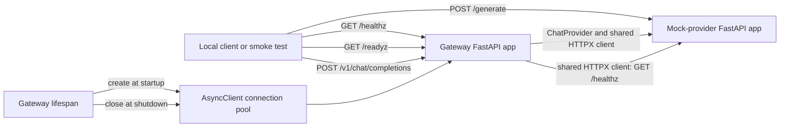

# Architecture

## Status and scope

This document describes the merged Phase 0 foundation plus the Phase 1B non-streaming gateway. The
broader product direction remains in [`BUILD_CONTRACT.md`](BUILD_CONTRACT.md); it is not an
assertion that those systems already exist.

## Current architecture: Phase 1B

The current system is an installable Python distribution containing two independent FastAPI/ASGI applications connected by one minimal readiness request:

```text
client -- GET /healthz --> gateway application
client -- GET /readyz --> gateway -- shared AsyncClient --> mock GET /healthz
client -- POST /v1/chat/completions --> gateway validation --> provider adapter
  --> shared AsyncClient --> mock POST /v1/chat/completions --> validated response

test client -- GET /healthz --> mock-provider application
test client -- POST /generate --> validation --> SHA-256 derivation --> mock response
test client -- POST /v1/chat/completions --> strict contract --> deterministic Chat Completion
```

Uvicorn runs each application as a separate process. FastAPI routes requests and serializes responses; strict Pydantic models reject unknown or invalid fields. The mock response is a pure function of a canonical JSON representation of the validated request, so it has no dependency on randomness, time, network calls, or process-local state.

The Chat Completions request and response models live in the shared boundary-contract module.
The gateway depends on the small `ChatProvider` protocol; its current `HttpxMockProvider` adapter
borrows the lifespan-managed client. There is no persistent store, cache, router, retry, fallback,
or evaluation workload.



## Application factories

`switchboard.gateway.create_app()` and `switchboard.mock_provider.create_app()` each return a new FastAPI instance. This keeps process construction explicit, avoids mutable global application state, and lets tests create isolated instances. Uvicorn receives the factory with `--factory` and owns the network listener and event loop.

## Current request flows

```text
gateway: GET /healthz
  -> route handler
  -> HealthResponse
  -> JSON 200

gateway: POST /v1/chat/completions
  -> request-ID middleware
  -> strict ChatCompletionRequest validation
  -> injected ChatProvider protocol
  -> HttpxMockProvider using shared AsyncClient
  -> validated ChatCompletionResponse or stable gateway error
  -> request ID response header

mock: POST /generate
  -> Pydantic validation
  -> canonical JSON serialization
  -> SHA-256 digest
  -> MockGenerationResponse
  -> JSON 200

mock: POST /v1/chat/completions
  -> strict ChatCompletionRequest validation
  -> canonical JSON serialization
  -> SHA-256 digest and controlled metadata fixtures
  -> ChatCompletionResponse
  -> JSON 200
```

Gateway validation failure stops before provider communication and produces the documented stable
error envelope. The mock provider retains FastAPI's direct 422 structure because it is a test
boundary, not the public gateway.

## Resource lifecycle

The gateway's lifespan context creates one `httpx.AsyncClient` before accepting requests, stores it
in application state, gives the provider adapter a borrowed reference, and closes it after the
lifespan exits. Readiness and completion requests reuse that client and connection pool. Buffered
provider responses are explicitly closed after validation. Tests prove adapter/client identity,
response-body closure, and final client shutdown without relying on garbage collection.

Creating a client per request was rejected because it would discard connection pooling and make socket cleanup harder. CPU work and synchronous blocking calls remain prohibited on the event loop in later phases.

## Container topology

Both services use one locked, non-root image, built once from the mock-provider service definition and reused by the gateway. Compose starts the mock provider first, waits for its `/healthz`, then starts the gateway with `SWITCHBOARD_MOCK_PROVIDER_URL=http://mock-provider:8001`. Gateway health checks call `/readyz`, proving service discovery and upstream reachability rather than process liveness alone. Only ports 8000 and 8001 are published to host loopback.

## Immediately planned architecture: Phase 1C

Phase 1C will add correctly scoped upstream streaming, SSE framing, `[DONE]`, backpressure,
disconnect cancellation, partial-stream failure rules, and real-network cancellation tests.

## Deferred architecture

Redis, PostgreSQL, Qdrant, authentication, tenant budgets, semantic caching, policy routing,
circuit breakers, metrics infrastructure, replay evaluation, SSE, and production deployment remain
deferred. Their appearance in the build contract is roadmap context, not current implementation
status.
